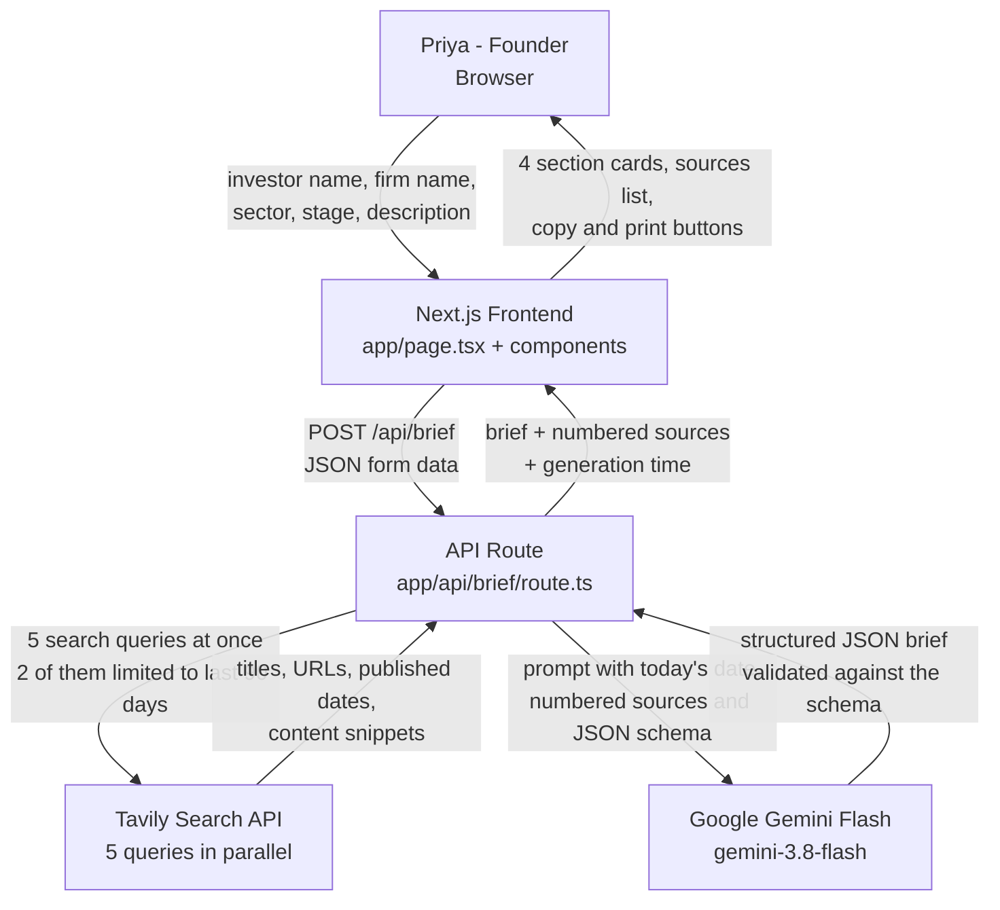

# Pre-Meeting Investor Brief

An AI agent for founders. Type an investor's name and their firm, and in well under
two minutes you get a structured, sourced briefing to read before the meeting.

Built for a founder called **Priya**, who runs a D2C startup and meets 3–4 investors a week.

- **Live URL:** **https://investor-brief-agent.vercel.app**
- **Components Map:** **https://investor-brief-agent.vercel.app/components-map** (also in [`docs/components-map.md`](docs/components-map.md))
- **GitHub:** https://github.com/anshutolasaria/investor-brief-agent
- **Plain-English walkthrough:** [`docs/EXPLAIN.md`](docs/EXPLAIN.md)

---

## What the brief contains

Every brief has exactly these sections:

1. **Recent Portfolio Activity** — new investments or exits in the **last 90 days**, with
   dates and source links.
2. **Investment Thesis** — the sectors, stages and beliefs the investor states publicly.
3. **Context & Red Flags** — sectors they have moved away from, controversies, pivots or
   failures in the portfolio.
4. **Three Talking Points** — specific openers tailored to Priya's sector and stage.

Plus a numbered **Sources** list at the bottom, a **data confidence** rating, and the
**generation time** in seconds.

---

## Tech stack

| Piece | What it is |
| --- | --- |
| [Next.js 16](https://nextjs.org) (App Router) | Frontend and the single API route, in one project |
| TypeScript | Types shared between the frontend and the backend |
| Tailwind CSS v4 | Styling, including the print stylesheet |
| [`@google/genai`](https://www.npmjs.com/package/@google/genai) | Google's official Gen AI SDK |
| **Gemini Flash** (`gemini-3.8-flash`) | The only AI model used anywhere in this app |
| [Tavily Search API](https://docs.tavily.com) | Live web and news search, called with plain `fetch` |
| Vercel | Hosting |

No database, no authentication, no other services.

---

## How it works



The full version, with a file-by-file table, is in [`docs/components-map.md`](docs/components-map.md).
The same diagram also renders live at **`/components-map`** on the deployed site.

---

## Project structure

```
app/
  page.tsx                   The home page: form, loading state, results
  layout.tsx                 Page shell and metadata
  globals.css                Tailwind plus the print stylesheet
  api/brief/route.ts         The whole backend pipeline, one POST endpoint
  components/
    BriefForm.tsx            The input form
    LoadingProgress.tsx      Progress text and the elapsed-time counter
    BriefView.tsx            Renders the four sections, sources, copy and print
    SectionCard.tsx          A reusable card wrapper
    SourceLink.tsx           A small "source" link
  components-map/page.tsx    The architecture diagram, rendered with Mermaid
lib/
  tavily.ts                  Builds and runs the 5 parallel live searches
  prompt.ts                  Builds the prompt text and the anti-hallucination rules
  gemini.ts                  Calls Gemini Flash with the JSON output schema
  types.ts                   Shared TypeScript types
docs/
  components-map.md          Architecture diagram and data flow
  EXPLAIN.md                 Plain-English walkthrough plus viva questions
```

---

## Setup

### 1. Install

```bash
npm install
```

### 2. Add your API keys

Copy the example file:

```bash
cp .env.example .env.local
```

Then open `.env.local` and paste your two keys:

```
GEMINI_API_KEY=...
TAVILY_API_KEY=...
```

- **Gemini key:** free from [Google AI Studio](https://aistudio.google.com/apikey).
- **Tavily key:** free tier at [app.tavily.com](https://app.tavily.com).

`.env.local` is git-ignored, so the keys never reach GitHub.

### 3. Run it

```bash
npm run dev
```

Open <http://localhost:3000>.

---

## Environment variables

| Name | Used for | Where it is read |
| --- | --- | --- |
| `GEMINI_API_KEY` | Calling Gemini Flash | Server only, in `app/api/brief/route.ts` |
| `TAVILY_API_KEY` | Calling Tavily Search | Server only, in `app/api/brief/route.ts` |

Both are read **only inside the API route**, which runs on the server. Neither key is
prefixed with `NEXT_PUBLIC_`, so neither is ever sent to the browser or included in the
JavaScript bundle.

---

## Deploying to Vercel

1. Push this repo to GitHub.
2. On [vercel.com](https://vercel.com), choose **Add New → Project** and import the repo.
3. Before the first deploy, open **Environment Variables** and add `GEMINI_API_KEY` and
   `TAVILY_API_KEY` with your real values, for all three environments.
4. Click **Deploy**.

The API route sets `export const maxDuration = 120`, which matches the two-minute goal.
Vercel's Hobby plan allows up to 300 seconds, so this is comfortably inside the limit.
In practice a brief takes about 15–40 seconds.

---

## Design decisions

### Why Tavily for search?

The exam rules require **live** external data. Tavily is a search API built for AI
pipelines: one HTTP call returns titles, URLs, published dates and a cleaned text
snippet per result, so there is no HTML scraping to write and no extra SDK to learn.
Two parameters matter a lot here:

- `topic: "news"` for the two recency queries, which surfaces reporting rather than
  evergreen marketing pages.
- `start_date` / `end_date`, which pin those queries to an exact 90-day window.
  Tavily's simpler `time_range` option only offers day / week / month / year, and none
  of those is 90 days.

### Why five searches, run in parallel?

One query cannot cover "what did they fund recently", "what do they say they believe",
and "what has gone wrong". Five narrower queries give much better coverage. They are
independent, so `Promise.all` runs them at the same time — the search stage costs about
as long as the single slowest query instead of the sum of all five.

### Why a JSON output schema?

The call to Gemini passes a `response_format` with a JSON schema, so the model must
return a fixed structure instead of free-form prose. This means:

- the frontend can render fields directly, with no text parsing and no regex;
- a missing section is impossible, because the schema marks every section as required;
- "three talking points" is enforced by the structure, not by hoping the model counts.

### How hallucination is prevented

Five layers, which is the part worth understanding:

1. **Sources are fetched first, never recalled.** The model only ever sees text that
   Tavily returned seconds earlier.
2. **The prompt forbids outside knowledge** explicitly: use only the numbered sources,
   never invent an investment, a date, a company, a number or a quote.
3. **Today's date is passed into the prompt**, along with the computed 90-day cutoff
   date. A model has no reliable idea what "today" is, so without this the 90-day rule
   cannot work. The prompt also says to drop any item whose date is missing or older
   than the cutoff.
4. **The model never writes a URL at all.** Each claim carries only a source *number*
   (`"sourceNumber": 3`), and the app looks the real URL up from the Tavily results. This
   was added after testing: the model once re-typed a long URL and silently dropped a word
   from it, producing a dead link. A number cannot be mangled that way, and a number that
   does not exist simply renders no link instead of a broken one.
5. **The Sources list shown to the user is built from the real Tavily results in the API
   route, not from the model's output.** Even if the model were to invent a URL inside a
   claim, the bibliography at the bottom of the page stays genuine.

On top of that, the schema includes a `dataConfidence` field (`high` / `medium` / `low`)
and a `confidenceNote`, and the prompt instructs the model to mark thin coverage as
`low` rather than padding the brief. For a lesser-known investor you should expect an
honest, short brief rather than an impressive, invented one.

### Why the startup profile fields?

The problem statement describes Priya as a D2C founder but never gives her sector,
stage or product. Section 4 has to be *tailored to her startup's stage and sector*, so
the app has to know them — otherwise the openers come out generic, which defeats the
point of the section. Rather than hard-coding guesses, the app asks for three fields and
pre-fills a sensible D2C example (sector "D2C / Consumer brands", stage "Seed") that
stays fully editable.

**Where they live in the UI matters too.** The case study says Priya *"enters an
investor's name and firm"* — that is the search, and those are the only two inputs on the
form. Her own startup does not change between meetings, so it sits in a collapsed "Your
startup" strip that shows the current values at a glance, opens with one click, and is
saved to `localStorage` so she sets it once rather than re-typing it for all 3–4 meetings
a week. Nothing is hidden: the strip always displays the sector and stage being used.
If storage is blocked, the defaults are used and nothing breaks.

### Why `window.print()` instead of a PDF library?

A print stylesheet in `globals.css` hides the form and buttons (`.no-print`), flattens
the cards, and appends the real URL after each link so a printed page stays usable.
`window.print()` then lets the browser's own "Save as PDF" do the work. That is zero
extra dependencies for a feature that behaves well on both desktop and mobile.

---

## Limitations

- **The brief is only as good as the search results.** A well-known investor gives a
  rich brief; a lesser-known one gives a short, honest one marked low confidence. That
  is the intended behaviour, not a bug.
- **Published dates are Tavily's best estimate.** Some pages do not expose a reliable
  date, so a genuinely recent item can occasionally be missed by the 90-day filter.
  Missing a real item is the safer failure here than inventing one.
- **No caching.** Every request runs fresh searches and a fresh model call, which costs
  API credits. There is no database, so nothing is stored between requests.
- **No login.** Anyone with the URL can use it and spend the API quota.
- **English-language sources only**, in practice.
- **Always verify before the meeting.** This is a research shortcut, not a fact-checked
  report.
