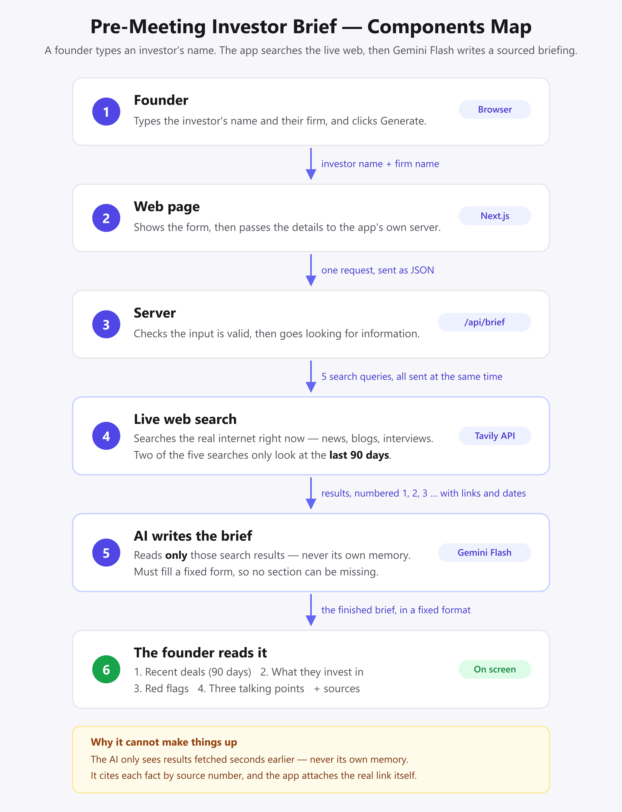
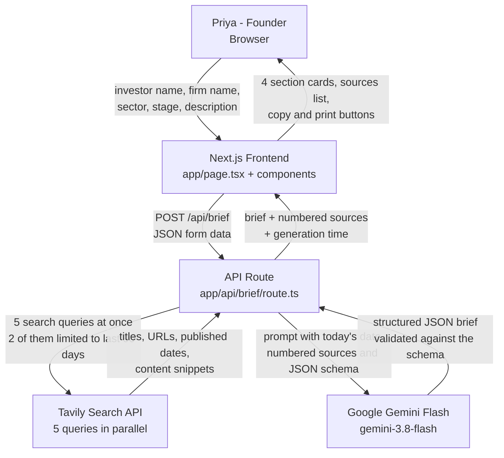

# Components Map

How a single request flows through the Pre-Meeting Investor Brief agent.
Every arrow is labelled with the data that travels along it.

The same diagram in Mermaid, for anyone who wants to edit it:

## The same flow in words

1. **Priya → Frontend.** She types the investor name, the firm name, and her own
   startup profile (sector, stage, one-line description) into the form.
2. **Frontend → API route.** The browser sends that as JSON to `POST /api/brief`.
3. **API route → Tavily.** The route validates the input, then fires **5 searches at
   the same time** with `Promise.all`. Two of them are restricted to the last 90 days
   using Tavily's `start_date` / `end_date` parameters, because the brief needs recent
   investments and exits. The other three look for evergreen material: thesis
   interviews, blog and podcast content, and controversies.
4. **Tavily → API route.** Each result comes back with a title, a URL, a published
   date (where Tavily could detect one) and a content snippet. The route merges all
   five result sets, drops duplicates by URL, and numbers them `[1]`, `[2]`, `[3]`…
5. **API route → Gemini Flash.** The numbered source list, today's date and the
   startup profile go into one prompt. The call also carries a **JSON schema**, so
   Gemini must return exactly the structure the frontend expects.
6. **Gemini Flash → API route.** A JSON object with the four required sections, a
   confidence rating, and a source *number* attached to each factual claim. The app turns
   that number into the real URL, so the model never writes a link itself.
7. **API route → Frontend.** The brief, the numbered source list (built from the real
   Tavily results, not from the model) and the generation time in seconds.
8. **Frontend → Priya.** Four section cards, a clickable Sources list, and the
   "Copy brief" and "Download as PDF" buttons.

## Where each file sits in the flow

| Step | File |
| --- | --- |
| Form and page state | `app/page.tsx`, `app/components/BriefForm.tsx` |
| Loading state and timer | `app/components/LoadingProgress.tsx` |
| The whole pipeline | `app/api/brief/route.ts` |
| Live search | `lib/tavily.ts` |
| Prompt text and rules | `lib/prompt.ts` |
| Gemini call and JSON schema | `lib/gemini.ts` |
| Shared TypeScript types | `lib/types.ts` |
| Rendering the brief | `app/components/BriefView.tsx`, `SectionCard.tsx`, `SourceLink.tsx` |
| This diagram, as a live page | `app/components-map/page.tsx` |
